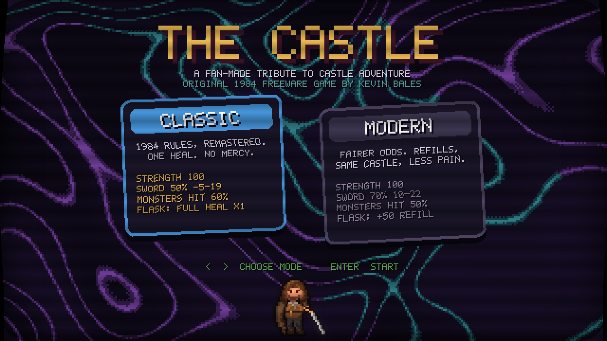
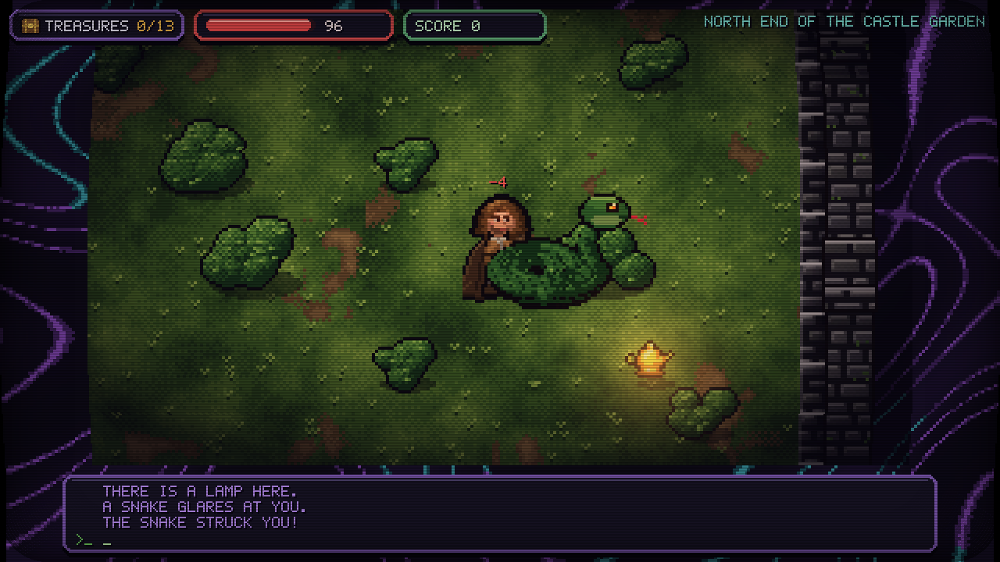
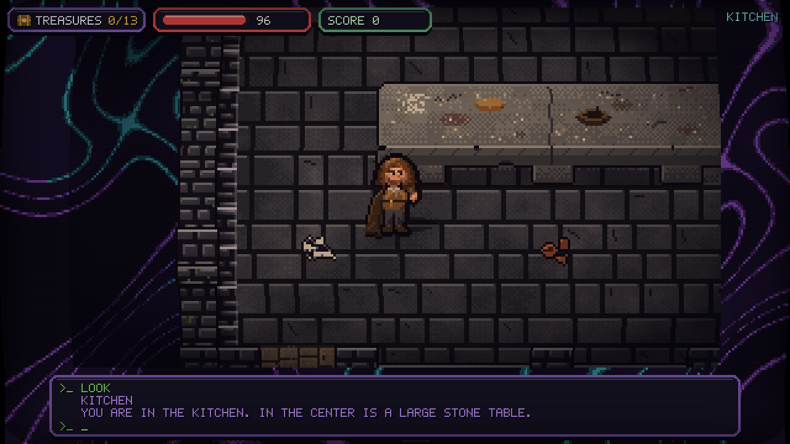
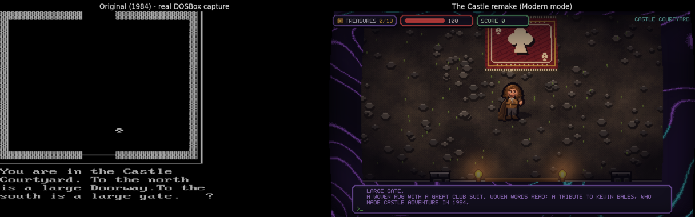
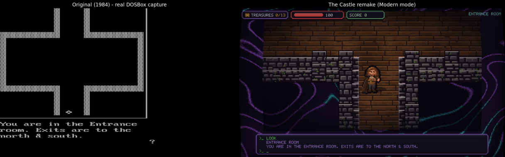
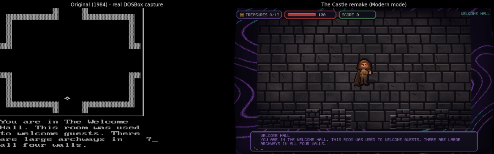

# The Castle

A fan remake of **Castle Adventure**, Kevin Bales' 1984 PC adventure game, in Python and pygame.
Explore a castle of 83 rooms, collect treasures, fight monsters, solve puzzles and escape through the gate.
Type commands at the prompt as in the original, or walk around with the arrow keys.

> **Unofficial fan remake.** The original **Castle Adventure (1984) is by Kevin Bales.**
>
> **Fan tribute. Unofficial and free.** Castle Adventure was created by Kevin Bales. All credit for the
> original game, its map, puzzles and text goes to him. This project is not affiliated with or endorsed by him.
> It is a non-commercial homage and will never be sold.

## Install and run

Requires Python 3.10+.

    git clone https://github.com/AgentXIIIno1/the-castle
    cd the-castle
    python -m venv .venv && source .venv/bin/activate   # Windows: .venv\Scripts\activate
    pip install -r requirements.txt
    python game/main.py

You can launch it from any directory: data and assets are found relative to `game/main.py`.
`cd game && python main.py` also works.

## Modes

Choose one on the title screen with the arrow keys and press Enter.

- **Classic**: the rules of the original CASTLE.EXE. Strength 100, hit chances of about 50/60%, one flask heal per game, no regeneration.
- **Modern**: the same castle and puzzles with a gentler real-time balance. You hit more often, monster damage depends on the monster,
  the helmet reduces damage, the flask heals +50 and can be refilled, and you slowly regenerate out of combat.

All values are in `game/config/classic.json` and `game/config/modern.json`, each tagged with its source.

## Controls

- **Arrow keys**: walk. Walk through an opening to change rooms, and walk into stairs to climb them.
- **Walk into a monster** to attack it (you need the sword).
- **Type a command and press Enter**: LOOK / EXAMINE <thing>, GET, DROP, INV, READ, WAVE, UNLOCK / OPEN DOOR, WEAR, PLAY, RUB,
  SAY, EAT, CLIMB, JUMP, FILL, DRINK, POUR, SCORE, HELP, and N / S / E / W.
- **F1**: toggle the CRT effect. **F2**: save the real window to `game/shots/readback.png`.
- **F11**: toggle borderless full screen at the desktop resolution. The window is also resizable. Bigger windows show
  **more of the room** at the same pixel size (one art pixel = 4 screen pixels). When the whole room fits, it is centred.
  Below 1280x720 the classic 640x360 framing is scaled to fit. The full-screen/window state is remembered in
  `~/.config/the-castle/settings.json` (Linux), `~/Library/Application Support/the-castle/settings.json` (macOS) or
  `%APPDATA%\the-castle\settings.json` (Windows).
- **HiDPI / Retina (macOS):** sizes are in points; macOS scales the window to the physical pixels, so the pixel art keeps
  the same apparent size, but the game does not render at the native Retina resolution.

Useful flags: `--no-crt` turns off the CRT effect.

## Screenshots

| | |
|---|---|
|  |  |
|  | |

## Original vs Remake

The same early rooms in Kevin Bales' 1984 original (left: real captures of the original CASTLE.EXE running in DOSBox)
and in this remake (right).

## Repository layout

    requirements.txt      pygame-ce, numpy
    game/main.py          entry point: game loop, parser, rules, rendering
    game/art3.py          room baking (tiles, walls, stairs); art.py and gfx.py hold the procedural art and surface helpers
    game/decor.py         seeded decorative props (decals and objects) per room
    game/setpiece.py      hand-placed set pieces per room
    game/pixfont.py       bitmap font
    game/config/          classic.json / modern.json rule sets
    game/data/            rooms.json, per-room layouts, room_themes.json
    game/assets/          sprites, tiles, manifests and the make_*.py scripts that generate them
    src/                  Seed7 reference sources (castle.sd7, castle.dat) and gen.py, which extracts game/data/ from them
    docs/screenshots/     README images

## Troubleshooting

If the game world (the room) is black, or the picture looks wrong:

- `python game/main.py --no-crt` runs without the CRT warp, scanlines and bloom.
- `CASTLE_SAFE=1 python game/main.py` is safe mode: no post effects at all, just a plain blit.
- **F1** in game toggles the CRT effect on and off.
- At startup the game prints a `[castle diag] {...}` line (pygame/SDL/numpy versions, platform, display bits and masks). It then runs
  a self-test that renders a test frame offscreen. If that frame comes out black, the CRT is disabled automatically and a `WARNING`
  line is printed. Please send both lines when you report a display problem.
- On Wayland, try `SDL_VIDEODRIVER=x11 python game/main.py` (XWayland).
- If you have plain `pygame` installed, switch to pygame-ce: `pip uninstall pygame && pip install pygame-ce` (same `import pygame`).
- numpy is optional. If it is missing or fails, pure-pygame fallbacks are used.

## Credits & License

**Castle Adventure** (1984) was written and designed by **Kevin Bales**. The room text, puzzles, map, item and
monster placements and the name are his work and are not covered by this project's licenses. The Castle is an
unofficial, free, non-commercial fan remake, not affiliated with or endorsed by him, and it will be taken down on
request.

The room data was extracted from **Thomas Mertes' Seed7 rewrite** (`castle.sd7` and `castle.dat`,
[github.com/ThomasMertes/seed7](https://github.com/ThomasMertes/seed7)), GPL-2.0-or-later. Both files are in
`src/` with their original notice.

- **Code, tools and generated data:** GPL-2.0-or-later, see [LICENSE](LICENSE).
- **Original artwork** in `game/assets/`: CC BY-NC 4.0, see [LICENSE-ART](LICENSE-ART).
- Details and the preserved Seed7 notice: [NOTICE](NOTICE).

Made by AgentXIIIno1 with AI-assisted code and art.
